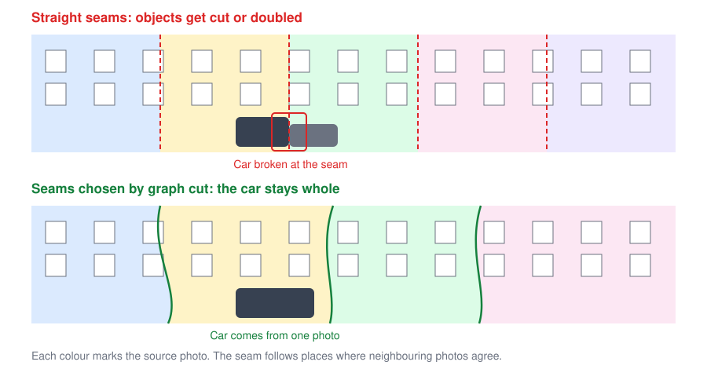

# StreetPano

[](https://github.com/retotito/StreetPano/actions/workflows/ci.yml)
[](LICENSE)

Open-source software for building very long street panoramas from photos taken
while walking along a street.

> **Status: early development.** The first window opens a folder and shows its photos,
> and developer tools can find camera positions. The app can't stitch yet.



## The problem

Walking along a street means every photo is taken from a different position.
The facade lines up, but anything in front of it, such as cars, trees and
people, shifts between photos. Ordinary panorama software assumes one viewpoint,
so these objects get cut or doubled.

## The approach

1. **Geometry does the aligning.** Camera positions are recovered from the
   photos, and each photo is projected onto the facade.
2. **Seams go around problems.** A graph cut chooses which photo supplies each
   pixel, so seams avoid foreground objects.
3. **You stay in control.** The software suggests objects. You accept them or
   click to add more, then choose to keep or remove each one.
4. **AI assists, and generated pixels are tracked.** Models find objects, and
   generative fill is used only for areas that no photo shows. Those pixels are
   recorded in a mask.
5. **Editing is non-destructive.** A project stores the original photos plus your
   decisions, so verticals, seams and slope settings can all be changed later.

## Documentation

| Topic | Page |
|---|---|
| Overview and goals | [Concept overview](docs/concept/overview.md) |
| How to shoot a street | [Capture guide](docs/concept/capture.md) |
| Processing steps | [Pipeline](docs/concept/pipeline.md) |
| Screens and workflow | [User interface](docs/concept/ui-workflow.md) |
| Marking objects | [Foreground objects](docs/concept/foreground.md) |
| Verticals and sloped streets | [Geometry correction](docs/concept/geometry-correction.md) |
| RAW, JPEG and output files | [File formats](docs/concept/formats.md) |
| Working on small computers | [Memory and disk](docs/concept/memory.md) |
| Models and licences | [AI models](docs/concept/ai-models.md) |
| Code structure | [Architecture](docs/development/architecture.md) |
| What gets built when | [Roadmap](docs/roadmap.md) |
| Why decisions were made | [Decision records](docs/adr/index.md) |

## Quick start

On macOS, you need [Homebrew](https://brew.sh) and [uv](https://docs.astral.sh/uv/).

```sh
brew install cmake ninja qtbase
git clone https://github.com/retotito/StreetPano.git
cd StreetPano
./scripts/dev.sh
```

This builds the app and opens a synthetic street. To open your own photos:

```sh
./scripts/dev.sh ~/Pictures/my-street
```

Use the left and right arrow keys to move along the street, the scroll wheel to zoom,
and double-click to fit the photo to the window.

## Developer tools

```sh
uv run --project tools streetpano estimate --length 500 --spacing 1
uv run --project tools streetpano synth my-street --length 30
```

See [tools/README.md](tools/README.md).

## Contributing

See [CONTRIBUTING.md](CONTRIBUTING.md).

## Licence

StreetPano's code is licensed under the [Apache License 2.0](LICENSE). It uses Qt under
the LGPL. AI models are separate downloads with their own terms, and some are limited to
non-commercial use. See [AI models](docs/concept/ai-models.md).
