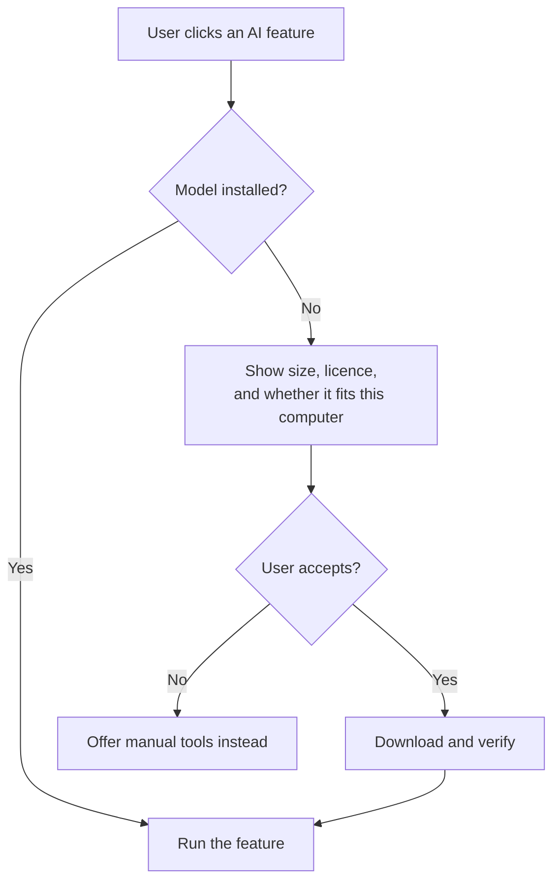

# AI models

No custom training is planned. Existing models cover each job, and the real work is
the pipeline, seam logic and review tool.

All models sit behind replaceable interfaces. None of them is required for the
classic baseline, and model weights are never stored in this repository.

| Job | Candidate | Status |
|---|---|---|
| Suggest objects | Mask2Former or similar, pretrained on street scenes | Ready to use |
| Outline an object from a click | SAM 2 | Ready to use |
| Follow an object across photos | SAM 2 with camera positions | **Needs testing** at 1 m spacing |
| Estimate depth, only if needed | Depth Anything 3 | Ready to use |
| Match photos and find positions | COLMAP, optionally LightGlue | Ready to use |
| Fill small gaps | LaMa | Quality needs testing |
| Fill larger gaps | Diffusion inpainting, DiffuEraser | Quality needs testing |

## Installing models

!!! note "Planned"
    This describes the design. The model manager doesn't exist yet. See the
    [decision record](../adr/0007-on-demand-model-manager.md).

The app works without any models, and downloads each one when a feature first needs
it. Nothing is downloaded on the start screen.



For example, clicking an object for the first time would offer to download SAM 2.
If the user declines, the lasso still works.

### Model manager

A screen in the app, and a matching command line, shows every model with:

| Information | Why it matters |
|---|---|
| Purpose | Which feature needs it |
| Download size and disk use | Disk space can be the tightest limit |
| Memory needed, and whether it fits this computer | Some models won't run on 8 GB |
| Licence | Some models are non-commercial only |
| Status | Not installed, installed, or update available |

Users can install, remove and update models there, and can choose where they're
stored, such as an external SSD.

```sh
streetpano models list
streetpano models install sam2-small
streetpano models remove sam2-small
```

### Rules

- **Licences are shown first.** A non-commercial model needs explicit acceptance
  before it downloads.
- **Downloads are verified.** The app uses a list of pinned versions and checksums,
  and it refuses a file that doesn't match.
- **Safe file formats are preferred.** Older PyTorch checkpoint files can run code
  when loaded, so `safetensors` is preferred wherever a model offers it.
- **Interrupted downloads resume.** Disk space is checked before a download starts.
- **Offline use is supported.** A model file can be imported from disk.
- **Updates are never automatic.** A new model version can change results, so each
  project records the versions it used.
- **Heavy models can run elsewhere.** A model that doesn't fit this computer can run
  on a remote GPU, or the app suggests a smaller version.

## When training might make sense

Only if testing shows a specific, repeated failure. The first option is
**fine-tuning** an existing model on a few hundred examples, which user corrections
could supply. Training a new model from scratch is not planned.

## Licences

Checked on 2026-11-04 against each project's GitHub repository. Licences change, so
check again before adding a dependency.

**A repository's licence does not always cover its weights.** Check both.

| Project | Licence | Notes |
|---|---|---|
| [SAM 2](https://github.com/facebookresearch/sam2) | Apache-2.0 | |
| [Depth Anything 3](https://github.com/ByteDance-Seed/Depth-Anything-3) | Varies by model | Small, Base and Metric-Large are Apache-2.0. Large, Giant and Nested are CC BY-NC 4.0. |
| [Mask2Former](https://github.com/facebookresearch/Mask2Former) | MIT | Repository archived. Check the licence of the training data for pretrained weights. |
| [COLMAP](https://github.com/colmap/colmap) | New BSD | In use through pycolmap, as an optional dependency. Now includes the GLOMAP global mapper. Some dependencies are licensed separately. |
| [LightGlue](https://github.com/cvg/LightGlue) | Apache-2.0 | Feature extractors may have different terms. |
| [VGGT](https://github.com/facebookresearch/vggt) | Custom | Only a specific checkpoint allows commercial use. |
| [LaMa](https://github.com/advimman/lama) | Apache-2.0 | |
| [DiffuEraser](https://github.com/lixiaowen-xw/DiffuEraser) | Apache-2.0 | Check the base models it depends on. |
| [ProPainter](https://github.com/sczhou/ProPainter) | S-Lab 1.0 | **Non-commercial only.** |
| [Netflix VOID](https://github.com/Netflix/void-model) | Apache-2.0 | [Reportedly needs 40 GB+ of VRAM](https://aitoolsatlas.ai/blog/netflix-void-ai-video-object-removal-open-source-2026). |
| [UDIS++](https://github.com/nie-lang/UDIS2) | Apache-2.0 | |

## Libraries

| Project | Licence | Notes |
|---|---|---|
| [OpenSeadragon](https://github.com/openseadragon/openseadragon) | BSD-3-Clause | |
| [libvips](https://github.com/libvips/libvips) | LGPL-2.1 | |
| [LibRaw](https://github.com/LibRaw/LibRaw) | LGPL-2.1 or CDDL-1.0 | |
| [rawpy](https://github.com/letmaik/rawpy) | MIT | |
| [Lensfun](https://github.com/lensfun/lensfun) | LGPL-3.0 | |
| [NumPy](https://github.com/numpy/numpy) | BSD-3-Clause | In use |
| [Pillow](https://github.com/python-pillow/Pillow) | MIT-CMU | In use |
| [PyMaxflow](https://github.com/pmneila/PyMaxflow) | **GPL** | **Avoid as a required dependency.** See below. |

## Open question: graph-cut library

PyMaxflow is GPL, which conflicts with the plan to distribute StreetPano under
Apache-2.0 if it's a required dependency. Options to evaluate:

1. OpenCV's graph-cut seam finder, which only handles pairs of images.
2. Our own max-flow implementation in Rust, which isn't a large algorithm.
3. PyMaxflow as an optional research-only dependency, to compare results.

See the [licensing decision record](../adr/0006-code-and-model-licensing.md).
