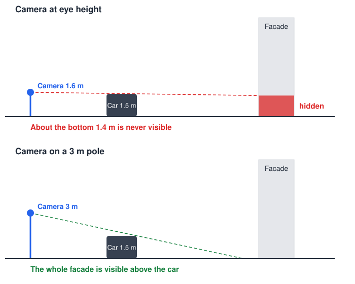

# Capture guide

!!! note "Untested recommendations"
    This guidance comes from geometry and general photography practice. It should
    be updated after the first test street.

## Photos or video?

Use **photos every 1–1.5 m**, which is about one shot per second at walking speed.
Closer spacing gives each part of the facade more viewpoints, so the software has
more real pixels to choose from behind each obstacle.

| | Photos | Video |
|---|---|---|
| Detail | About 4 mm/px with a 24 MP camera | About 6 mm/px at 4K |
| Quality | RAW, little compression | Compressed |
| Viewpoints | Fewer | Very dense |
| Object tracking | Harder across large gaps | Natural fit |
| Amount of data | Smaller | Larger |

This choice [needs a side-by-side test](../adr/0003-photos-as-main-capture.md).

## Camera settings

- Lock exposure, white balance and focus.
- Use a shutter speed of 1/500 s or faster.
- Turn off auto HDR, in-camera lens correction and similar automatic adjustments.
- Shoot RAW if possible. See [File formats](formats.md).

## How to walk

- Stay at a steady distance from the facade.
- Keep the camera level and pointed straight at the buildings.
- Leave extra space above the rooftops, because correcting tilt crops the image.
- Overlap the start and end of each section when you pause.

## When to shoot

- Choose overcast light if possible, because moving shadows and bright sun make
  photos harder to match.
- Choose quiet times, so there are fewer people and moving cars.
- Consider two passes at different times, because parked cars and people may have
  moved between them.

## Parked cars: use a higher camera

A row of parked cars hides the lower facade from every position along the street,
so walking further cannot reveal it. For a 1.5 m tall car about 5–7 m from the
camera and a facade 15 m away:

If you need the ground floors behind parked cars, a pole gives you real pixels
where the alternative is AI-generated ones. A pole also makes it harder to keep
the camera steady and level, so test it first.

## Privacy

If you publish panoramas, faces and number plates may need to be blurred. Check
the rules that apply where you shoot and publish.
