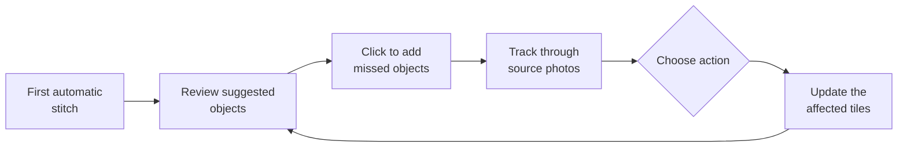

# Foreground objects

Users mark an object once on the panorama, and the software finds it in the source
photos. At 1 m spacing, the same car can appear in 10–20 photos, so marking each
photo by hand wouldn't be practical.

## Workflow

A click on an object produces an outline using SAM 2. A lasso stays available for
hard cases, such as tree branches.

!!! warning "Biggest technical risk"
    SAM 2 is designed for video, and objects jump a long way between photos taken
    1 m apart. Known camera positions can predict where an object should appear,
    but this has to be tested early. See the [roadmap](../roadmap.md).

## Actions

| Action | Best for | What happens | Generated pixels |
|---|---|---|---|
| **Keep whole** | Parked cars, trees, street furniture | All of the object comes from one photo, and seams go around it | None |
| **Remove** | People, moving cars, poles | The hole is filled with facade pixels from other photos | None |
| **Remove and fill** | Objects with nothing visible behind them | AI fills only the part that no photo shows | Some, recorded in a mask |
| **Keep and rescale** (later) | Nearby cars that look oversized | The object is scaled to match the facade, and the uncovered area is filled as above | Possibly |

Before a removal is confirmed, the interface shows how much of the hole real
photos can cover, for example "92% real, 8% generated".

## Why objects aren't simply repaired by AI

Seam problems come from mixing different viewpoints. **Keep whole** removes that
cause by taking the object from one photo, and every pixel stays real.

## Storage

Masks are stored against the source photos, not panorama coordinates. If they were
tied to the panorama, changing a vertical or slope setting would leave them in the
wrong place. See the [decision record](../adr/0004-non-destructive-project-model.md).

User corrections are also saved in a form that could become training data if
fine-tuning a model ever proves worthwhile.
