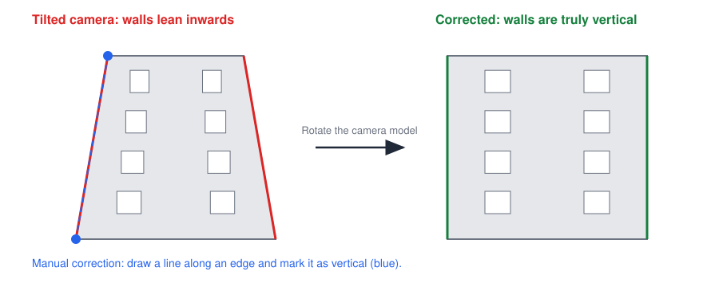
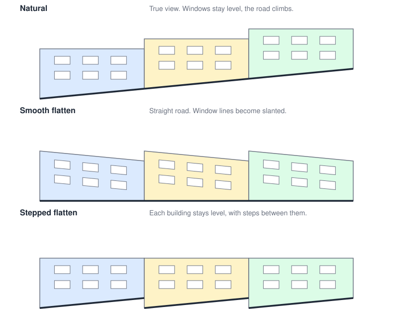

# Geometry correction

Verticals and slope are separate controls, and both can be changed after stitching.

## Vertical lines

StreetPano corrects the camera's tilt rather than warping each photo separately.
This keeps neighbouring photos consistent with each other.

| Level | How it works |
|---|---|
| **Automatic** | Detect building edges and use them, with the camera positions, to estimate true "up" along the street. |
| **Semi-manual** | Draw a line along a building edge and mark it as vertical. The software adds this as a constraint and blends the correction into the nearby section. |
| **Manual** | Use a tilt slider for a selected section, for areas with no clear edges. |

## Sloped streets

All three modes keep verticals vertical. They differ in how they treat the road
and horizontal lines.

| Mode | Result | Downside |
|---|---|---|
| **Natural** (default) | True view, with the road visibly climbing and window lines level | The image gets taller |
| **Smooth flatten** | Straight road, with each column moved up or down | Window lines become slanted |
| **Stepped flatten** | Each building stays level, with steps between buildings | Terraced buildings have few natural places for a step |

The extra height in natural mode can be significant. A 500 m street at a 5% slope
rises 25 m, which adds about 6,700 px at 3.75 mm/px.

## Curved streets and buildings

Streets and facades often curve, but a panorama is usually wanted as one straight
strip. StreetPano first has to follow the real shape, because this can't be fixed
afterwards by bending a finished image.

The canvas is a surface that follows the facades along the walk. Laying that surface
out flat, like unrolling a label from a bottle, gives the straight panorama. The
facades keep their proportions, and the bend becomes distance along the strip.

Straight is built. The other two modes are planned.

| Mode | Result | Downside |
|---|---|---|
| **Straight** (default) | One straight strip, with rooflines level along each facade | The bend no longer shows, so directions and overall distances aren't true |
| **True shape** | Keeps the bend that a single flat plane would show | The image gets taller, and rooflines curve |
| **Partial** | A slider between the two | Rooflines stay slightly curved |

Limits to test on real streets:

- A gentle curve unrolls well, but a sharp corner needs a clear break between
  sections.
- Different distances to the facades need a surface for each one, with a transition
  between them where nothing important is lost.
- Side streets and open gaps have no surface to follow, so what's behind them will
  look stretched or compressed.

Like slope mode, this is an output setting, so changing it never requires marking
objects again.

## Road profile

The road profile comes from the camera's height along the walk and appears as a
curve that the user can edit. It assumes the camera stays at a steady height above
the road, so hand-held wobble needs smoothing.

Slope mode is an output setting, so switching modes never requires marking objects
again.
