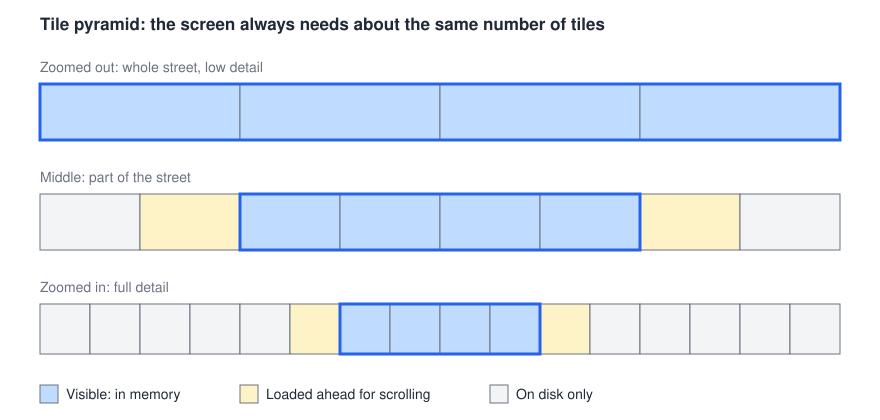

# Memory and disk

StreetPano must run on modest computers. The reference low-end machine has **8 GB
of RAM and limited free disk space**.

## The rule

**Memory use must depend on the screen and the job's section size, never on the
street's length.**

## Viewer: tiles instead of whole photos

Loading whole photos doesn't scale. A 24 MP photo at 16-bit takes about 144 MB, and
zooming out to a whole street could involve hundreds of them. Like online maps, the
viewer uses small tiles at several zoom levels:

1. Visible tiles load first. A blurry lower-resolution tile appears right away, and
   the sharp one replaces it.
2. Tiles just off screen load ahead of time, so scrolling feels smooth.
3. When scrolling quickly, requests for tiles already passed are cancelled.
4. When the cache is full, the least recently used tiles are dropped. They can be
   reloaded from disk.

A 4K screen touches at most 54 tiles of 512 × 512 px at once, or about 54 MB
uncompressed. A cache of about 0.5 GB therefore leaves plenty of room for scrolling.

## Processing

| Step | How memory is limited |
|---|---|
| RAW development | A few photos at a time, with results saved to disk |
| Final rendering | Streamed in pieces with pyvips |
| Seam finding | One section at a time, with overlap, first at low resolution and then refined near the seam |
| Choice of source photos | Only the 5–8 best photos for each spot, although about 22 can cover the same point at 1 m spacing |
| AI models | A smaller image or crop, one at a time, with the model unloaded afterwards |
| Editing an object | Only affected tiles are recalculated, using previews until full quality is requested |

## Budgets

The user sets a maximum memory, with a default based on the computer's RAM. Heavy
steps run through a job queue, which sets parallelism from the available budget.

| On an 8 GB computer | Budget |
|---|---|
| Operating system and other apps | ~3.5 GB |
| Viewer tile cache | ~0.5 GB |
| Pipeline working memory | ~4 GB |

These are starting values to be measured and adjusted. AI models may not fit within
this budget at useful quality, so the design allows them to run on a remote GPU.

## Size estimates

These assume a 24 MP camera, 3.75 mm/px on the facade, and a 4,000 px tall panorama.

| | 500 m | 5 km |
|---|---:|---:|
| Panorama, uncompressed 8-bit | 1.6 GB | 16 GB |
| Panorama, uncompressed 16-bit | 3.2 GB | 32 GB |
| Developed photos at 1 m spacing, uncompressed | 72 GB | 720 GB |
| Viewer tile cache | ~0.5 GB | ~0.5 GB |

## Disk space

Disk space may become a problem before memory does:

- Intermediate files are compressed, and anything that can be regenerated goes in a
  size-limited cache.
- Developed photos are not all kept. They are regenerated from the originals when
  needed.
- The estimated disk space appears before a job starts, and the job won't start if
  there isn't enough.
- An external SSD is a supported location for project data.

## Reliability

Progress is saved after each section, so a crash on a long street doesn't mean
starting over. An automated test runs a long synthetic street under a memory cap
and fails if the cap is exceeded. See [Testing](../development/testing.md).
