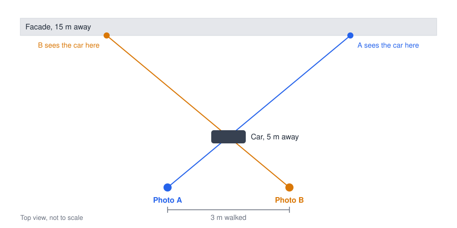

# Concept overview

## Goal

Walk along a street, photograph the buildings on the other side, and turn those
photos into one continuous panorama that can be hundreds of metres or kilometres
long, with facades that are sharp and correctly aligned.

## The core problem: parallax

An ordinary panorama is taken from one position. A street panorama is taken from
many positions, so nearby objects shift against the facade from photo to photo.

The shift grows quickly as an object gets closer to the camera. These figures
assume a 24 mm lens on a full-frame camera, a 6000 px wide image, and a facade
15 m away:

| Object | Shift at 3 m spacing | Shift at 1 m spacing |
|---|---:|---:|
| Balcony, 1.5 m in front of the facade | ~89 px | ~30 px |
| Car or tree, 8 m from the camera | ~700 px | ~233 px |
| Car or person, 5 m from the camera | ~1600 px | ~533 px |

No single image transformation can align both the facade and a car, because they
would need different corrections.

## The approach

StreetPano handles the problem in layers, using the simplest method that works:

1. **Project onto the facade.** Camera positions recovered from the photos allow
   each photo to be projected onto the facade, which aligns everything on it.
2. **Choose seams.** A cheapest path decides where each photo takes over, so that seams
   run where neighbouring photos agree.
3. **Treat objects explicitly.** Each foreground object is kept whole from one
   photo, or removed using facade pixels from other photos.
4. **Generate only as a last resort.** AI fills only what no photo shows, and
   those pixels are recorded in a mask.

## Principles

- **Real pixels first.** A photo of the facade is always better than a generated
  guess.
- **People make the final decision.** Automation proposes, and the user can
  override it. No automatic result is expected to be perfect across a whole street.
- **Every decision can be changed.** See
  [the non-destructive project model](../adr/0004-non-destructive-project-model.md).
- **It must run on modest computers.** Memory use must not grow with street
  length. See [Memory and disk](memory.md).

## Out of scope for now

- Real-time processing during capture
- Full 3D street reconstruction
- Video as the main input, until a side-by-side test justifies it
  ([decision record](../adr/0003-photos-as-main-capture.md))

## Prior work

- Agarwala et al., *Photographing Long Scenes with Multi-Viewpoint Panoramas*,
  SIGGRAPH 2006: the closest match to this approach.
- [A Unified Framework for Street-View Panorama Stitching](https://cvrs.whu.edu.cn/panostitching/):
  warping, colour correction, graph-cut seams and pyramid blending.
- [UDIS++](https://arxiv.org/abs/2302.08207): deep learning for parallax-tolerant
  stitching, worth evaluating as a later experiment.
- [Street panorama technique](https://panoramastreetline.com/technique-street-panorama-strassenzug):
  a practitioner's account of doing this by hand.
