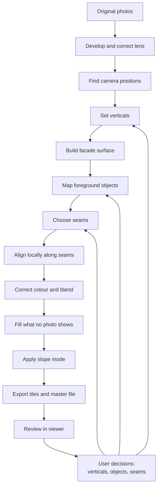
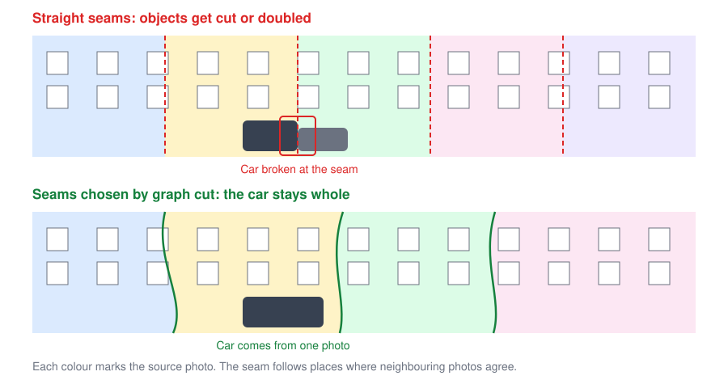

# Pipeline

The pipeline turns photos and user decisions into a panorama. Every step can be
rerun, and its results can be regenerated from the original photos.

## Steps

### 1. Develop and correct lens

Convert RAW files using the same settings for the whole sequence, then remove lens
distortion. Otherwise, straight lines stay slightly curved no matter how well the
verticals are corrected. See [File formats](formats.md).

### 2. Find camera positions

Run structure-from-motion with COLMAP. Sequential matching suits a walk along a
street, and it reduces false matches between similar-looking windows.

Long sequences can drift, so we expect to need priors such as GPS or a roughly
straight path. VGGT is fast, but [pose reliability fell as image counts grew in an
aerial benchmark](https://arxiv.org/abs/2507.14798), so it's a candidate only for
short sections.

### 3. Set verticals

Estimate true "up" automatically, and accept manual corrections.
See [Geometry correction](geometry-correction.md).

### 4. Build facade surface

Fit a plane to each facade section and join the planes along the street. This
surface is the panorama's canvas. Curved streets and buildings at different
setbacks are the main unknowns here.

### 5. Map foreground objects

Give each pixel in each photo a score for how likely it is to be foreground:

- **Parallax check:** warp neighbouring photos onto the facade. Anything that
  doesn't line up is in front of the facade or moving. This needs no AI.
- **Segmentation:** detect cars, people and trees.
- **User marks:** see [Foreground objects](foreground.md).

A per-pixel median across the warped photos gives a "clean plate", which removes
thin or moving objects using real pixels.

### 6. Choose seams

A graph cut chooses the source photo for each pixel, balancing three costs:

- Prefer pixels that aren't foreground.
- Prefer seams where neighbouring photos agree.
- Keep every pixel of a "keep whole" object from a single photo.

### 7. Align locally

Use optical flow to fix small mismatches along seams, such as the depth of window
frames.

### 8. Correct colour and blend

Match colour between photos, then apply Laplacian pyramid blending to hide what
remains of the seams.

### 9. Fill what no photo shows

Inpaint only the remaining gaps, and record those pixels in a mask.

### 10. Apply slope mode

Render as natural or flattened. See [Geometry correction](geometry-correction.md).

### 11. Export

Write viewer tiles and a master file. See [File formats](formats.md).

## Alternatives considered

| Approach | Assessment |
|---|---|
| Deep stitching such as UDIS++ | It works on image pairs. A later experiment for seams and alignment, but not a foundation. |
| Photogrammetry orthophoto | A useful comparison. [Strong on large textured walls, weaker on thin elements such as railings](https://isprs-archives.copernicus.org/articles/XLVIII-2-W12-2026/383/2026/). |
| Gaussian splatting | Can help with [reflections](https://isprs-archives.copernicus.org/articles/XLVIII-2-W8-2024/371/2024/), but may add soft edges and halos. A later experiment. |
