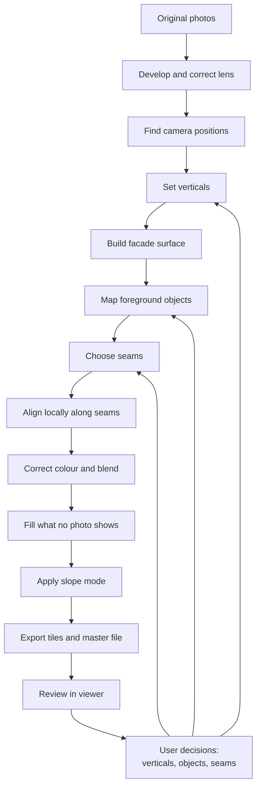
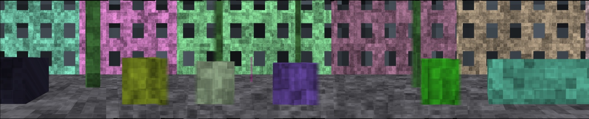

# Pipeline

The pipeline turns photos and user decisions into a panorama. Every step can be
rerun, and its results can be regenerated from the original photos.

## Current state

The first version works from end to end, using only some of these steps:

- **Built:** camera positions, a facade surface that follows the street, seams that go around objects, and brightness matching.
- **Not built yet:** lens correction, RAW, marking objects to keep or remove, and pyramid
  blending.

The picture above is from an earlier synthetic street, with straight seams.

On a real street of 27 phone photos, the facades and their lettering mostly line up, the
strip stays straight, and most cars stay whole. The seams also
[edit the scene without asking](../adr/0013-cheapest-path-seams.md), removing or repeating
some objects, and some rooflines keep a gentle bow. Lens distortion isn't corrected yet.

## Steps

### 1. Develop and correct lens

Convert RAW files using the same settings for the whole sequence, then remove lens
distortion. Otherwise, straight lines stay slightly curved no matter how well the
verticals are corrected. See [File formats](formats.md).

### 2. Find camera positions

Run structure-from-motion with COLMAP. Sequential matching suits a walk along a
street, and it reduces false matches between similar-looking windows.

!!! warning "Flat facades need special care"
    Two photos alone aren't enough on a nearly flat scene. In a test on a synthetic
    street, the direction of travel from two photos had a median error of 3° to 80°,
    depending on the distance between them. COLMAP avoids this by optimising across
    all photos together.

    COLMAP also can't separate focal length from facade distance on such a scene, so
    [focal length must stay fixed](../adr/0008-fixed-focal-length.md).

Results from COLMAP with a fixed focal length, on 40 m synthetic streets at 1280 ×
720 px with about 2 cm of hand-held wobble unless stated:

| Condition | Rotation error, median | Position error, median | Facade (true 15 m) |
|---|---:|---:|---:|
| Flat street, 1 m spacing | 0.009° | 0.2 cm | 15.00 m |
| 5% slope | 0.011° | 0.3 cm | 15.00 m |
| Camera tilted up 10° | 0.006° | 0.2 cm | 15.00 m |
| 8 cm of wobble | 0.014° | 0.4 cm | 15.00 m |
| 3 m spacing | 0.030° | 0.9 cm | 14.99 m |
| 5 m spacing | 0.021° | 0.9 cm | 15.00 m |
| 8 m spacing | 0.079° | 2.3 cm | 15.00 m |

COLMAP's default settings are made for unordered photo collections. Limiting images to
2000 px and 5000 features, and matching only the 8 nearest photos, took 16 photos of 12 MP
from 417 s to 9.5 s on an 8 GB laptop, with the same accuracy on a synthetic street.

These results are the best case. The scenes have perfect lenses, a known focal
length and unique textures, without repeating windows or changing light. Real photos
will be worse, and longer streets may drift.

Long sequences can drift, so we expect to need priors such as GPS or a roughly
straight path. VGGT is fast, but [pose reliability fell as image counts grew in an
aerial benchmark](https://arxiv.org/abs/2507.14798), so it's a candidate only for
short sections.

COLMAP can split a real street at a weak link, or bend and collapse it while still
reporting a low error. So each result is checked as a walk, split where it breaks, and
[joined again](../adr/0011-check-and-join-camera-paths.md) using neighbouring photos.

### 3. Set verticals

Estimate true "up" automatically, and accept manual corrections.
See [Geometry correction](geometry-correction.md).

### 4. Build facade surface

At each camera, fit a straight facade line through the nearby 3D points above camera
height, and join those distances into a smooth wall that follows the street. Then adjust
the wall at each seam until neighbouring photos agree. Laying that wall out flat gives the
panorama's canvas. See the
[decision record](../adr/0012-facade-surface.md).

### 5. Map foreground objects

Give each pixel in each photo a score for how likely it is to be foreground:

- **Parallax check:** warp neighbouring photos onto the facade. Anything that
  doesn't line up is in front of the facade or moving. This needs no AI.
- **Segmentation:** detect cars, people and trees.
- **User marks:** see [Foreground objects](foreground.md).

A per-pixel median across the warped photos gives a "clean plate", which removes
thin or moving objects using real pixels.

### 6. Choose seams

For each photo, a [cheapest path](../adr/0013-cheapest-path-seams.md) from top to bottom
decides where it takes over from what's already drawn, balancing these costs:

- Prefer seams where the photos agree.
- Prefer seams near the middle of the strip, where views are less oblique.
- Later, keep every pixel of a "keep whole" object from a single photo, and avoid pixels
  marked as foreground.

### 7. Align locally

Use optical flow to fix small mismatches along seams, such as the depth of window
frames.

### 8. Correct colour and blend

Match colour between photos, then apply Laplacian pyramid blending to hide what
remains of the seams.

### 9. Fill what no photo shows

Inpaint only the remaining gaps, and record those pixels in a mask.

### 10. Apply slope mode

Render as natural or flattened. See [Geometry correction](geometry-correction.md).

### 11. Export

Write viewer tiles and a master file. See [File formats](formats.md).

## Alternatives considered

| Approach | Assessment |
|---|---|
| Deep stitching such as UDIS++ | It works on image pairs. A later experiment for seams and alignment, but not a foundation. |
| Photogrammetry orthophoto | A useful comparison. [Strong on large textured walls, weaker on thin elements such as railings](https://isprs-archives.copernicus.org/articles/XLVIII-2-W12-2026/383/2026/). |
| Gaussian splatting | Can help with [reflections](https://isprs-archives.copernicus.org/articles/XLVIII-2-W8-2024/371/2024/), but may add soft edges and halos. A later experiment. |
