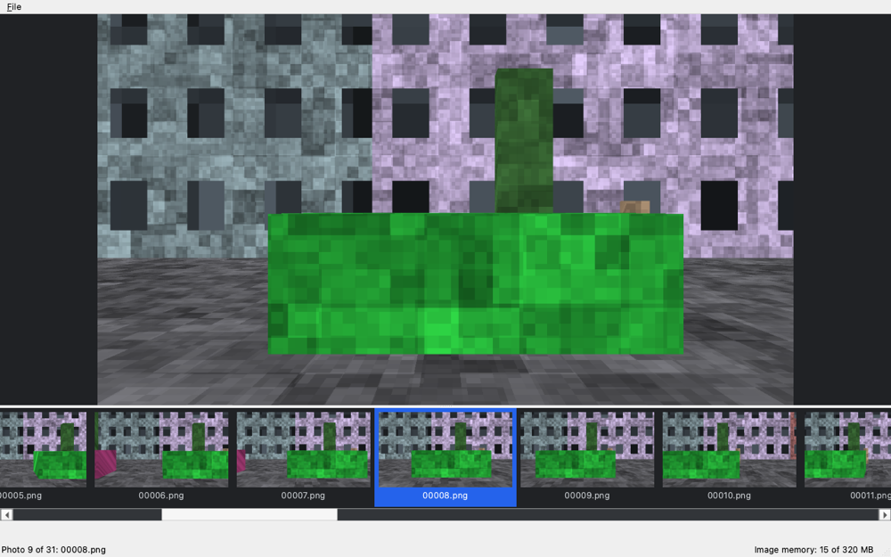
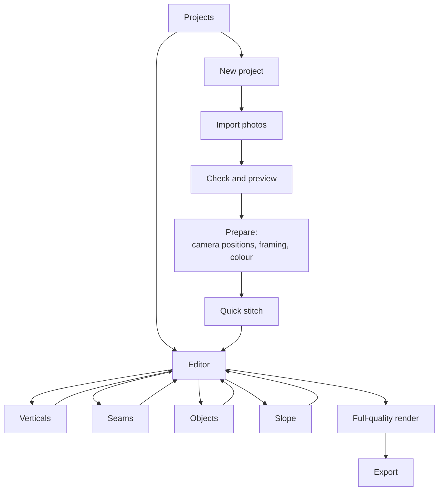
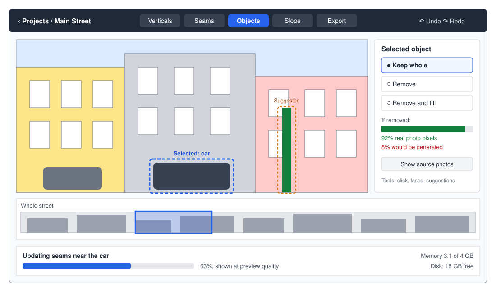
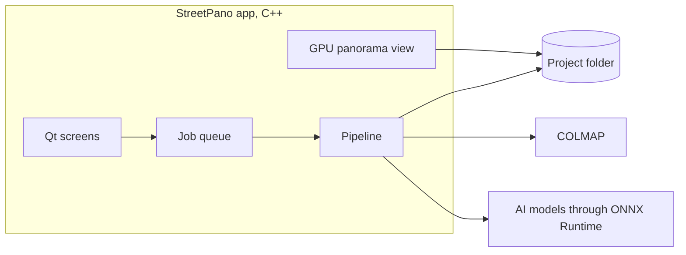

# User interface and workflow

!!! note "Mostly planned"
    A first window exists, which opens a folder and shows its photos. The rest of this
    page describes the planned design.

## Built so far

The steps along the top of the window are built in a first form. You can always go back to an
earlier step.

| Step | What you do there |
|---|---|
| **Projects** | Create a project for a folder of photos, or open a recent one. Photos are used where they are and never copied |
| **① Photos** | Check the photos and stitch them |
| **② Align** | Coming next: all photos side by side with guide lines, adjusting a few by hand and the rest automatically |
| **③ Edit** | Mark areas, remove or keep objects, describe fixes, and the edits panel |
| **④ Export** | Save the panorama with its edits, as JPEG, PNG or TIFF |

## Workflow

## Screens

### Projects

Shows each project with a thumbnail, street length, status and disk use. Users can
open, duplicate or delete a project. Deleting a project never touches the original
photos.

A **demo street** creates a synthetic project, so people can try the app without
taking any photos.

### New project

Asks for a name and a storage location, such as an external SSD. Photos are referenced
rather than copied, because copying could quickly fill a small disk.

### Import photos

Accepts a folder or dropped files, then checks them before any slow work begins:

| Check | Why it matters |
|---|---|
| Same camera, lens and zoom | [Focal length has to be fixed](../adr/0008-fixed-focal-length.md) |
| Focal length available | If it's missing, the app asks the user |
| Time order and gaps | Finds a broken sequence or a missed section |
| Blurred or very different exposures | These photos make poor seams |
| Disk space needed | Warns before a job starts |

### Check and preview

A film strip shows every photo in order. Users can exclude bad photos, reverse the
walking direction, and split a sequence where they paused.

### Prepare

Everything here has a sensible default, so users can go straight to stitching:

- Find camera positions, then show the walking path and facade from above.
- Set the framing, such as how much sky and road to keep.
- Check automatic verticals.
- Choose colour settings for the whole sequence.

### Quick stitch

The first stitch runs at low resolution, so problems appear in minutes rather than
after a long full render. Corrections then use the same preview quality.

### Editor

The panorama stays in the centre, with a strip below it for moving along the street.
Each tab adds its own tools:

| Tab | What users can do | What gets recalculated |
|---|---|---|
| **Verticals** | Check the automatic result, draw vertical lines, and adjust tilt for a section | Projection and seams in that section, which is slow |
| **Seams** | See seams, choose which photo to use in an area, and move a seam | Nearby tiles |
| **Objects** | Accept suggestions, click or lasso objects, and choose keep or remove | Nearby tiles |
| **Slope** | Switch between natural, smooth and stepped, and edit the road profile | Final output step only, which is fast |
| **Export** | Choose the output | Nothing, until export starts |

### Export

| Output | Use | Limit |
|---|---|---|
| **BigTIFF master** | Archiving and further editing | Very large files |
| **Web viewer folder** | Zoomable tiles for a website | |
| **JPEG sections** | Sharing or printing parts of a street | A JPEG can't exceed 65,535 px per side, so long streets are split |
| **Reduced image** | Quick sharing | Less detail |

Export can also save the mask of generated pixels and a list of the decisions made.

## Design rules

- **Automatic first, and the user decides.** Each step gives a good result without
  input, and keeps its decisions as data that can be changed later without redoing
  other work. The user can always point at an object, such as a damaged car or a
  person, and tell the AI to [correct or remove it](foreground.md).
- **Any order, nothing lost.** Every correction is a saved decision that can be
  undone. The tabs run from most to least disruptive, so working left to right
  avoids redoing work.
- **Warn before losing work.** Changing verticals in a section can invalidate manual
  seam edits there. The app says which edits are affected, and offers to keep them
  where possible.
- **Long jobs never block the screen.** They run in the background, show progress and
  can be cancelled or resumed.
- **Show the source.** Any part of the panorama can show which photo it came from.
- **Generated pixels are visible.** An overlay marks them.
- **Memory and disk are always visible.** See [Memory and disk](memory.md).

## Stack

See the [decision record](../adr/0010-cpp-and-qt.md).

Everything runs on the user's computer, and nothing is uploaded.
