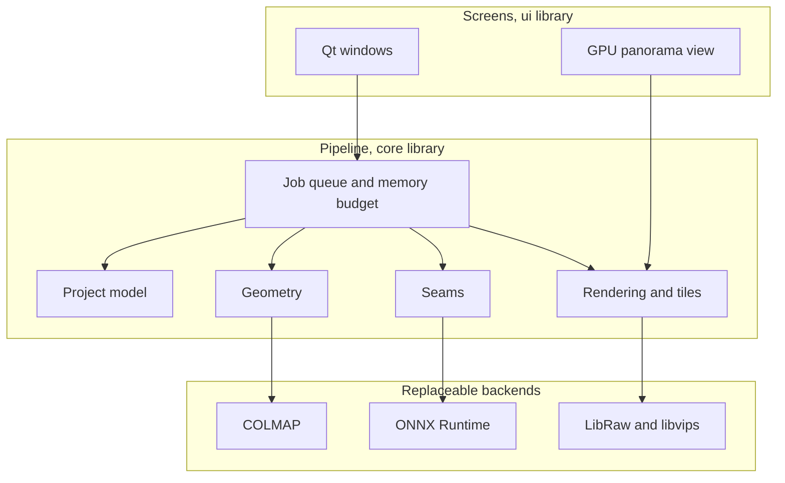

# Architecture

!!! note
    Most of this is planned. Today, the app has a first window and a simple stitcher, and
    camera positions still come from a Python tool. See the [roadmap](../roadmap.md).

## Components



The `core` library doesn't depend on Qt, so that it stays fast to test and can run
without a screen.

## Stack

| Area | Choice | Reason |
|---|---|---|
| Language | C++20 | Performance, and direct use of the main libraries |
| Screens | Qt 6 Widgets | Proven in image software, and runs on Mac, Windows and Linux |
| Build | CMake with presets, and Ninja | The standard for C++ with Qt |
| Tests | Catch2 for `core`, Qt Test for screens | Qt Test can run real windows without a display |
| Developer tools | Python, managed with uv | Synthetic streets and accuracy measurement |

See the [decision record](../adr/0010-cpp-and-qt.md).

## Repository layout

```text
app/                 Program entry point
src/core/            Pipeline, with no Qt
src/stitch/          Stitching with real files, using Qt only for images and JSON
src/ui/              Qt screens
tests/core/          Catch2 tests
tests/ui/            Qt Test screen tests
tests/sanitizers/    Rules for problems inside system libraries
scripts/dev.sh       Builds and opens the app
scripts/stitch.sh    Takes a folder of photos through to an open panorama
tools/               Python developer tools
docs/                This documentation
```

## Planned `core` layout

```text
src/core/
├── lru_cache        Memory-budgeted cache (exists)
├── photo_listing    Finding photos in a folder (exists)
├── facade_surface   The wall that follows the buildings (exists)
├── seam_match       Adjusting the wall until photos agree (exists)
├── patch            Filling a marked area from one photo (exists)
├── stitch_plan      Panorama layout and drawing strips (exists)
├── project/         Project files, decisions and masks
├── ingest/          RAW and JPEG loading, lens correction
├── poses/           Camera positions through COLMAP
├── surface/         Verticals, facade surface, slope modes
├── foreground/      Parallax check, segmentation, tracking
├── seams/           Graph cut and local alignment
├── render/          Blending, tiles and export
├── jobs/            Job queue and memory budget
└── models/          Model list, downloads and verification
```

## Project on disk

A project stores original photos by reference plus decisions. The cache can be
deleted at any time.

```text
my-street.streetpano/
├── project.json     Version, settings, photo list
├── decisions/       Verticals, objects, seam edits, slope settings
├── masks/           Object masks, per source photo
├── poses/           Camera positions
├── cache/           Regenerable: developed photos, previews, tiles
└── exports/         Finished panoramas
```

## Memory and thread rules

These are mandatory, and CI enforces as much as it can:

- **Ownership is automatic.** Use containers, `std::unique_ptr` and RAII. Qt objects
  are created with `makeChild`, which gives them a parent to own them. Plain `new`,
  `delete` and C allocation are forbidden elsewhere.
- **One owner per cache.** A cache belongs to one thread. Other threads pass it results
  by message.
- **Workers get copies.** Background work receives its own inputs, and it shares only
  mutex-guarded queues with the owner.
- **Destructors wait.** An object that owns workers joins them in its destructor, so a
  result can't reach an object that no longer exists.
- **Memory is budgeted.** Anything that holds images has a size limit, and a test
  enforces it.

## Rules for dependencies

- Core logic must not depend on a specific AI model. Models sit behind interfaces.
- `project.json` carries a format version, and older versions must keep loading.
- Non-commercial models and weights are never required, and are never included.
- Qt is linked dynamically, using only modules available under the LGPL.
