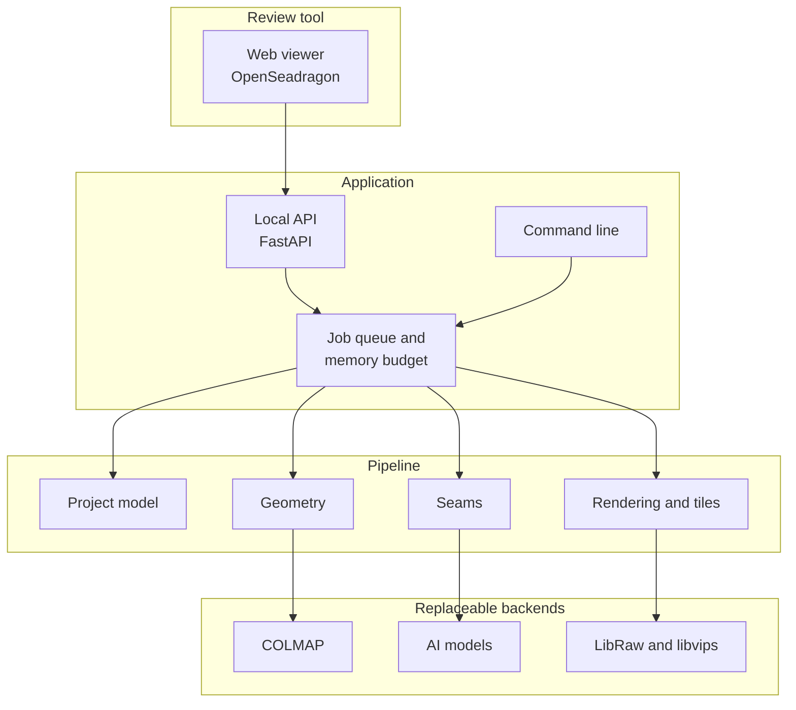

# Architecture

!!! note
    This is the planned structure. Today, the package contains only `geometry`,
    `sizing`, `synthetic`, `poses` and `cli`.

## Components



## Stack

| Area | Choice | Reason |
|---|---|---|
| Pipeline | Python, PyTorch, OpenCV, pyvips | Most vision and AI tooling is built for it |
| Slow parts | Rust through PyO3, only after profiling | Fast and memory-safe |
| Review tool | Local web app with FastAPI and OpenSeadragon | Deep-zoom viewing already exists |
| Environment | uv | Fast, with a reproducible lockfile |

See the [decision record](../adr/0001-python-first-rust-for-slow-parts.md).

## Planned package layout

```text
src/streetpano/
├── geometry.py      Capture geometry (exists)
├── sizing.py        Size estimates (exists)
├── synthetic.py     Test streets with exact ground truth (exists)
├── poses.py         Camera positions through COLMAP (exists)
├── cli.py           Command line (exists)
├── project/         Project files, decisions and masks
├── ingest/          RAW and JPEG loading, lens correction
├── surface/         Verticals, facade surface, slope modes
├── foreground/      Parallax check, segmentation, tracking
├── seams/           Graph cut and local alignment
├── render/          Blending, tiles and export
├── jobs/            Job queue and memory budget
├── models/          Model list, downloads and verification
└── server/          Local API for the review tool
```

## Project on disk

A project stores original photos by reference plus decisions. The cache can be
deleted at any time.

```text
my-street.streetpano/
├── project.json     Version, settings, photo list
├── decisions/       Verticals, objects, seam edits, slope settings
├── masks/           Object masks, per source photo
├── poses/           Camera positions
├── cache/           Regenerable: developed photos, previews, tiles
└── exports/         Finished panoramas
```

## Rules for dependencies

- Core logic must not import a specific AI model. Models sit behind interfaces.
- `project.json` carries a format version, and older versions must keep loading.
- Non-commercial models and weights are never required, and are never included.
