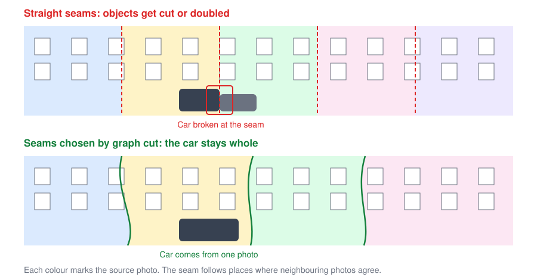

# StreetPano

StreetPano is open-source software for building very long street panoramas from
photos taken while walking along a street.

!!! warning "Concept stage"
    This documentation describes the planned design. The stitching pipeline does
    not exist yet, and its methods have not been tested on real streets.
    See the [roadmap](roadmap.md) for the current state.

## Where to start

- **New to the project:** read the [concept overview](concept/overview.md).
- **Taking photos:** follow the [capture guide](concept/capture.md).
- **Writing code:** start with the [architecture](development/architecture.md)
  and [testing](development/testing.md) pages.
- **Asking why something is the way it is:** see the
  [decision records](adr/index.md).
