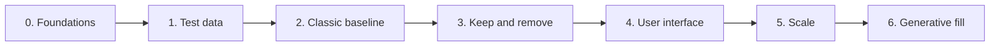

# Roadmap

Each phase ends with something that can be evaluated. Later phases may change based
on those results.

## 0. Foundations (done)

- [x] Repository, CI, tests and documentation
- [x] Concept and decision records
- [x] Planning calculations
- [x] C++ and Qt project, with memory checks in CI
- [x] First window: open a folder, film strip and photo view

## 1. Test data

- [ ] Shoot the same 100 m of street as both photos and video
- [x] Build a generator for synthetic test streets
- [ ] Decide between [photos and video](adr/0003-photos-as-main-capture.md)

**Done when:** the capture method is chosen based on real results.

## 2. Classic baseline, no AI

- [x] Load JPEG and PNG photos
- [ ] Correct lens distortion, and load RAW
- [x] Find camera positions with COLMAP, measured against synthetic streets, using a
  Python tool
- [ ] Find camera positions from the app, in C++
- [x] Read focal length from photo metadata
- [x] Test camera positions on real photos: 26 of 27 phone photos of a real street
  connect, with [checked paths and joined sections](adr/0011-check-and-join-camera-paths.md)
- [x] [Follow curved streets and different building setbacks](adr/0012-facade-surface.md),
  with verticals from the average camera direction
- [x] Straighten facades: fit lines, and adjust the wall until photos agree at seams
- [ ] Let users correct the wall where the automatic distance is wrong, and level
  rooflines by hand
- [x] First stitch with straight seams and a short blend, shown in the app
- [x] [Cheapest-path seams](adr/0013-cheapest-path-seams.md) that go around objects, and
  brightness matching between photos
- [ ] Pyramid blending

**Done when:** 100 m of street produces a panorama with aligned facades.

## 3. Keep and remove

This tests the core idea, and the riskiest part of it, early.

- [x] [Mark areas by hand](adr/0014-edits-as-saved-decisions.md) on the panorama, and choose
  which photo fills them, with undo
- [ ] Choose the best photo for "keep whole" and "remove" automatically
- [ ] Add the parallax check and clean plate
- [ ] Test SAM 2 tracking across photos

**Done when:** marked objects are never cut or doubled in the test street.

## 4. User interface

See the [planned workflow](concept/ui-workflow.md).

- [x] First preview screen
- [ ] Projects and import screens
- [ ] GPU tile viewer
- [ ] [Model manager](concept/ai-models.md#installing-models), including download, verification and licences
- [ ] Click to mark objects, and review suggestions
- [ ] Manual vertical lines and seam corrections
- [ ] Local updates

**Done when:** a user can fix a whole test street without touching code.

## 5. Scale

- [ ] Job queue and memory budgets
- [ ] Resume after a crash
- [ ] Test on 1 km or more, including curved streets and hills
- [ ] Slope modes
- [ ] [Straight and true-shape output](concept/geometry-correction.md#curved-streets-and-buildings)
  for curved streets and buildings

**Done when:** 1 km renders on an 8 GB computer within its memory budget.

## 6. Generative fill

- [ ] Compare inpainting models
- [ ] Fill leftover gaps and record a mask
- [ ] Show real and generated shares

**Done when:** every generated pixel can be identified in the output.

## Ideas for later

Not planned yet.

- Optional building outlines from open map data, such as OpenStreetMap or swisstopo,
  to guide facade shapes, give real distances and help connect separate parts of a
  street. The app must still work offline and where map data is poor.
