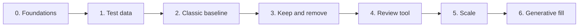

# Roadmap

Each phase ends with something that can be evaluated. Later phases may change based
on those results.

## 0. Foundations (done)

- [x] Repository, CI, tests and documentation
- [x] Concept and decision records
- [x] Planning calculations

## 1. Test data

- [ ] Shoot the same 100 m of street as both photos and video
- [x] Build a generator for synthetic test streets
- [ ] Decide between [photos and video](adr/0003-photos-as-main-capture.md)

**Done when:** the capture method is chosen based on real results.

## 2. Classic baseline, no AI

- [ ] Load photos and correct lenses
- [ ] Find camera positions with COLMAP, measured against synthetic streets
- [ ] Constrain rotation, because [flat facades make pose estimation unstable](concept/pipeline.md#2-find-camera-positions)
- [ ] Correct verticals automatically and build the facade surface
- [ ] Choose a [licence-compatible graph cut](concept/ai-models.md)
- [ ] Choose seams, then blend

**Done when:** 100 m of street produces a panorama with aligned facades.

## 3. Keep and remove

This tests the core idea, and the riskiest part of it, early.

- [ ] Mark objects by hand in source photos
- [ ] Implement "keep whole" and "remove"
- [ ] Add the parallax check and clean plate
- [ ] Test SAM 2 tracking across photos

**Done when:** marked objects are never cut or doubled in the test street.

## 4. Review tool

- [ ] Tile viewer
- [ ] Click to mark objects, and review suggestions
- [ ] Manual vertical lines and seam corrections
- [ ] Local updates

**Done when:** a user can fix a whole test street without touching code.

## 5. Scale

- [ ] Job queue and memory budgets
- [ ] Resume after a crash
- [ ] Test on 1 km or more, including curved streets and hills
- [ ] Slope modes

**Done when:** 1 km renders on an 8 GB computer within its memory budget.

## 6. Generative fill

- [ ] Compare inpainting models
- [ ] Fill leftover gaps and record a mask
- [ ] Show real and generated shares

**Done when:** every generated pixel can be identified in the output.
